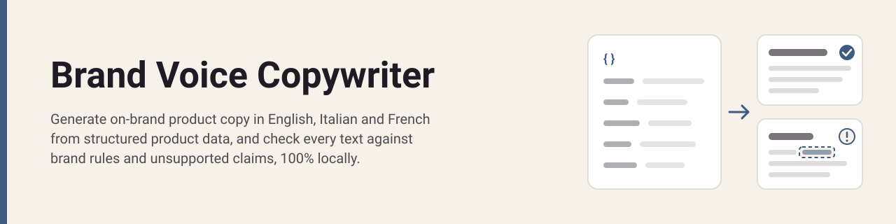
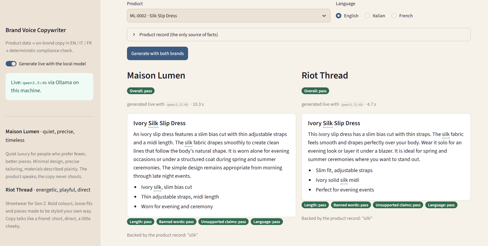
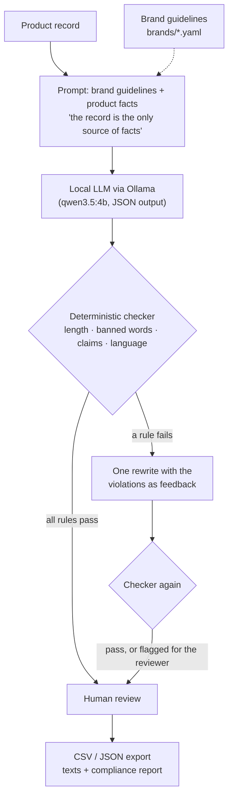
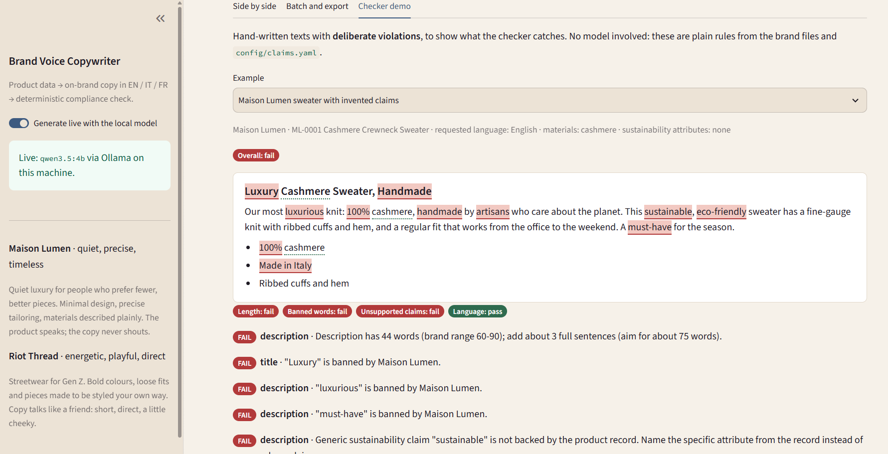
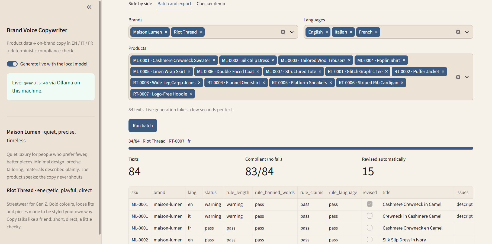

<p align="center">
  
</p>

# Brand Voice Copywriter

**Write on-brand product copy in English, Italian and French from structured product data, and check every text against brand rules and unsupported claims before a person approves it, running 100% locally.**

[](https://github.com/tortonef/brand-voice-copywriter/actions/workflows/ci.yml)

[](LICENSE)


## In 30 seconds

Give it a product record and a brand's guidelines, and a small open model running on your own machine writes a title, a description and three bullets in each language.
Every text then goes through **plain, deterministic rules**: length, the brand's banned words, the right language, and claims such as "organic", "made in Italy" or "waterproof" that the product record does not back up. A failing text gets one automatic rewrite; what still fails is flagged for the reviewer.
On the 84 sample texts, **82 pass every rule after that rewrite** (68 on the first try), at about 6 seconds per text.

<p align="center"></p>

## The business problem

Every new SKU needs a title, a description and bullets, in every language the store sells in, every season. Writing and translating them is slow, it competes with every other launch task, and the tone drifts between in-house writers, agencies and translators.

The bigger risk is **what the copy promises**. A copywriter in a hurry writes "sustainable", "100% cashmere" or "made in Italy" for a product the data does not support. Each of these is a reputational and regulatory exposure, and today they are caught, if at all, by a person rereading every text.

**Who feels it:** e-commerce content teams, brand managers, localization teams and whoever signs off claims before launch.

## Business value

| | Before (write and translate by hand) | After (generate, auto-check, human review) |
|---|---|---|
| Time per SKU per language | ~20 min to write or translate | ~5 min to review a draft that already passed the rules |
| Brand consistency | Depends on who wrote it | Same guidelines file for every text, banned words enforced |
| Unsupported claims | Found by rereading, or not at all | Flagged with the exact words highlighted, before review |
| Time to market for a collection | Copy is often the last thing ready | Drafts for all languages minutes after the product data exists |

**Example, with illustrative assumptions:** 800 new SKUs per season × 3 languages × 15 minutes saved per text ≈ **600 hours per season**.

Assumptions behind these figures (replace them with your own data):
- 20 minutes to write or translate one text and 5 minutes to review a draft are **estimates, not measurements**.
- 800 new SKUs per season is an example volume for a mid-sized online fashion retailer.
- The 98% pass rate comes from 84 texts on 14 sample products; real catalogs will differ.
- Savings assume the product data is complete. Copy cannot be better than the record it is written from.

## How it works



Design choices:
- **The checker is plain code, not another model.** Asking an LLM whether an LLM's text is compliant would just move the risk. The rules are readable files: banned words in each [brand file](brands/maison-lumen.yaml), risky claims and what can back them in [`config/claims.yaml`](config/claims.yaml). Same input, same verdict, every time.
- **The product record is the only source of facts.** A claim passes only when a field backs it: "organic" needs an organic material, a percentage must appear in the record, "sustainable" needs `sustainability_attrs` (and even then stays a warning, because the specific attribute is the better claim). Origin, handmade, waterproof and climate claims always fail, because the shared [product schema](schema/product.schema.json) has no field that can prove them.
- **Local and privacy-first.** The model runs on your machine through Ollama; product data is never sent anywhere. The app listens on `localhost` only and works offline after setup.
- **Human in the loop.** The tool drafts and checks; a person approves. Warnings (generic eco wording, a description slightly too short) are left for that person, not hidden.
- **Works without the model.** If Ollama is not running, the app opens in demo mode with texts pre-generated by the same model, and the checker still runs live on them.

## Quickstart

**Requirements:** Python 3.12, [Ollama](https://ollama.com/download), 8 GB RAM, about 5 GB of free disk. No accounts, no API keys. A GPU is used if Ollama finds one, but is not needed.
The first setup downloads about 3.5 GB (mostly the 3.3 GB model) and takes 10–20 minutes depending on your connection.

**Windows (PowerShell)**
```powershell
git clone https://github.com/tortonef/brand-voice-copywriter.git; cd brand-voice-copywriter
powershell -ExecutionPolicy Bypass -File .\setup.ps1
powershell -ExecutionPolicy Bypass -File .\run.ps1
```

**macOS / Linux**
```bash
git clone https://github.com/tortonef/brand-voice-copywriter.git && cd brand-voice-copywriter
bash setup.sh
bash run.sh
```

The app opens at <http://localhost:8501>. Without Ollama, setup still completes and the app opens in demo mode.

<details>
<summary>Troubleshooting</summary>

- **"running scripts is disabled on this system"**: use the `powershell -ExecutionPolicy Bypass -File ...` form above; it does not change any system setting.
- **Python 3.12 not found**: install it from [python.org](https://www.python.org/downloads/). On Windows the setup uses the `py -3.12` launcher, which the installer adds by default.
- **"Ollama not found" during setup**: install it (Windows: `winget install --id Ollama.Ollama -e`), open a new terminal and run the setup again. It pulls the model and continues.
- **Demo-mode banner although Ollama is installed**: start the Ollama app (or `ollama serve`) and reload the page.
- **The first generation is slow**: the model is loaded into memory on the first call. On a laptop without a GPU expect about 40 seconds per text.
- The setup is safe to run more than once.
</details>

## Using it

1. **Side by side** (screenshot above). Pick a product and a language: the same record is written in both brand voices. Each text shows a pass / warning / fail badge per rule, the offending words are highlighted (hover for the reason), and claims backed by the record are listed. When the first draft failed, the original attempt and its problems sit in an expander under the final text.
2. **Checker demo.** Hand-written texts with deliberate violations: "100% cashmere" and "Made in Italy" on a product whose record says neither, an off-brand word, a wrong language, and a clean control text whose "organic, GOTS certified" claims are backed. No model involved.

<p align="center"></p>

3. **Batch and export.** Run every product × brand × language, see how many passed, and download the texts with their rule results as CSV (opens in Excel) or JSON. The screenshot shows a separate live run, so its counts (83/84 passing, 15 rewrites) differ slightly from the evaluation below: the model's output varies between runs.

<p align="center"></p>

The two fictional brands are deliberately far apart:

| | Maison Lumen: quiet luxury | Riot Thread: Gen Z streetwear |
|---|---|---|
| Tone | quiet, precise, timeless | energetic, playful, direct |
| Bans (sample) | "luxury", "must-have", "trendy" | "elegant", "timeless", "classic" |
| Same silk slip dress, closing line | *The garment requires no embellishment to command attention in its simplicity.* | *Let the silk move naturally as you walk.* |

## Evaluation

Results from `python -m brand_voice.evaluate`: 14 products × 2 brands × 3 languages = 84 texts, generated with `qwen3.5:4b`. The same run produced the demo-mode texts in [`data/sample_outputs/`](data/sample_outputs). Full report: [`docs/eval_results.md`](docs/eval_results.md).

| Metric | Result |
|---|---|
| Pass every rule on the first attempt | 68/84 (81%) |
| Pass every rule after one automatic rewrite | **82/84 (98%)** |
| Pass with no warnings either | 57/84 (68%) |
| Time per text, NVIDIA RTX 2060 laptop GPU | ~6 s |
| Time per text, CPU only (AMD Ryzen 7 4800H, 3 calls) | ~37 s, ~54 s for the first call |

| Rule | Failed on first attempt | Failed after rewrite |
|---|---|---|
| Length | 11 | 2 |
| Banned words | 3 | 0 |
| Unsupported claims | 3 | 0 |
| Language | 0 | 0 |

**Weaknesses to be clear about:**
- **Length is the weak spot.** A 4-billion-parameter model cannot count words; it writes descriptions near the low end of the range. Asking for a number of sentences instead of words fixed most of it, but 2 Maison Lumen texts still end at 49 words against a minimum of 60, and 23 more carry a length warning.
- **The checker only knows what its rules cover.** It catches listed claims, not every invented detail. In the samples, "maintains its shape through repeated wear" passes although the record says nothing about durability. A person still reads every text.
- **It flags conservatively.** A material named anywhere counts, even in a styling tip ("pair it with wool trousers" on a nylon jacket). This is why the prompt no longer asks for pairing suggestions.
- **The claim lexicon is checked in the requested language only.** An English claim inside a French text is caught by the language rule, not by the claim rule.
- **Small sample.** 14 products and one model run: indicative, not a benchmark. The voices differ clearly, but the quiet-luxury voice is flatter than a senior copywriter's would be.

## Responsible AI, limitations and risks

- **It helps flag risks; it does not guarantee compliance.** The claim lexicon covers common risky wording in three languages. It is not legal advice and not exhaustive, and green-claims rules differ by market and change over time. Claims still need sign-off by someone accountable.
- **Generated text can be wrong in ways no rule sees**, e.g. a detail the record does not contain or a tone that misses. The workflow assumes a human review of every text before publication.
- **Bias and tone.** The model reflects its training data. Brand guidelines steer the voice but do not remove stereotypes; review copy for products aimed at specific groups with particular care.
- **Data.** Brands, products and texts are fictional, written for this demo. No real brand, person or customer data is used. See [`CREDITS.md`](CREDITS.md).
- **Privacy.** Product data stays on the machine; the app is reachable only from the same computer.

## From demo to production

| Area | What a real rollout would need |
|---|---|
| Integration | Read product records from the PIM; write approved copy back per locale through its API, with versioning and an audit trail of who approved what. |
| Human-in-the-loop workflow | A review queue in the tools the content team already uses; failed and warned texts first; clean texts sampled. |
| Rules and governance | Brand files owned by brand managers; the claim lexicon owned by legal or compliance and reviewed per market; a change log for both. |
| Evaluation | A fixed set of real SKUs and approved texts per brand and language, re-run before any change to the model, prompt or rules; native speakers rate tone. |
| Monitoring | Pass rate per rule, rewrite rate, reviewer edit distance and the claims reviewers add or remove, per brand and language. |
| Quality | A larger local model or a fine-tune on approved copy; a fact check that compares every attribute named in the text with the record. |
| Change management | Pilot with one brand and one category, measure review time against the assumptions above, then expand; show writers that the tool drafts and they decide. |
| Run costs | No per-call fees. One gaming-class GPU writes ~600 texts per hour; a CPU-only laptop ~100. A shared GPU server covers a season's catalog overnight. |

**Next steps (not built):** editing a text in the app with the checker re-running live, a translation glossary per brand, comparing two models side by side, SEO keywords.

## Models & licenses

| Component | License | Source |
|---|---|---|
| Qwen3.5-4B (`qwen3.5:4b` in Ollama) | Apache-2.0 | [Model card](https://huggingface.co/Qwen/Qwen3.5-4B) |
| Ollama (local model runtime) | MIT | [github.com/ollama/ollama](https://github.com/ollama/ollama) |
| langdetect (language check) | Apache-2.0 | [github.com/Mimino666/langdetect](https://github.com/Mimino666/langdetect) |
| Brands, products, rules and sample texts | MIT (this repo) | [`CREDITS.md`](CREDITS.md) |
| This code | MIT | [`LICENSE`](LICENSE) |

<details>
<summary>Project structure</summary>

```
app.py                      Streamlit UI (side by side, batch and export, checker demo)
config.yaml                 Ollama host and model, timeouts, paths, languages (env vars can override)
config/claims.yaml          Risky-claim lexicon per language and the record fields that can back each claim
brands/*.yaml               Brand guidelines: tone, do/don't, vocabulary, banned words, length rules, examples
schema/product.schema.json  Product record shared by the three repos in this series
src/brand_voice/
  checker.py                Deterministic rules: length, banned words, claims, language
  prompt.py                 Prompt builder and the JSON shape the model must return
  llm.py                    Ollama client (standard library only), output parsing
  pipeline.py               Generate, check, one rewrite; serialization of results
  export.py                 CSV and JSON export with rule results
  evaluate.py               Runs everything, writes docs/eval_results.md and the demo-mode samples
  data.py, config.py        Loading and validation of the files above
  smoke.py                  Used by the setup scripts
data/products.json          14 sample products (2 fictional brands)
data/seeded_violations.json Hand-written texts for the checker demo
data/sample_outputs/        Texts pre-generated with qwen3.5:4b, used in demo mode
tests/                      Unit tests (LLM mocked); test_llm_slow.py calls the real model
setup.ps1, setup.sh         One-time setup; run.ps1, run.sh start the app
```

Run the tests with `.venv/Scripts/python -m pytest -m "not slow"` (Windows) or `.venv/bin/python -m pytest -m "not slow"` (macOS/Linux).
</details>

## License

MIT, see [`LICENSE`](LICENSE).
